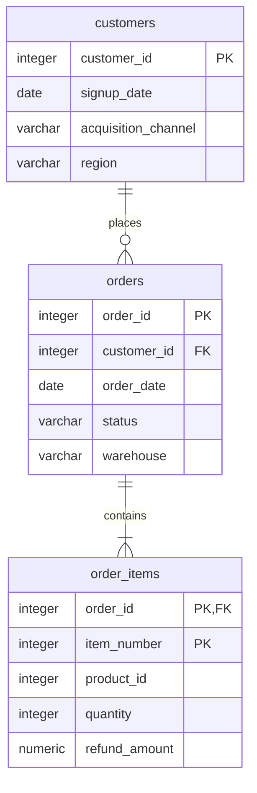

# Northstar Retail: 30 PostgreSQL Business Challenges

A complete retail analytics case study: three related tables, 650 synthetic records, reusable reporting views, 30 SQL solutions, exported results, and business recommendations.

**Status:** Executed on PostgreSQL 18.4 · **Validation:** 32/32 checks passed · **Period:** 2025 · **Currency:** INR

## Start here

- [All 30 answers, SQL, findings and result previews](ANSWERS.md)
- [One-page leadership memo](LEADERSHIP_MEMO.md)
- [Connect PostgreSQL and use VS Code / GitHub](HOW_TO_USE.md)
- [Complete CSV results](results/)

## What the analysis found

| Metric | Result |
|---|---:|
| Customers / orders / item lines | 60 / 210 / 380 |
| Delivered / cancelled / in transit | 196 / 13 / 1 |
| Qualifying purchasing customers | 54 |
| Paid merchandise value | INR 402,292.50 |
| Net revenue including shipping | INR 368,767.00 |
| Contribution under case assumptions | INR 109,557.00 |
| Weighted contribution margin | 29.71% |
| Largest ranked exposure | Electronics refunds: INR 21,640 |

- North Hub triggers three consecutive delivery warnings in August–October.
- Wireless Earbuds has 11 returns among 40 mature purchased units (27.50%).
- The highest-spending 11 customers contribute 48.33% of paid sales and 48.82% of contribution.
- No category meets the specified growth-plus-five-point-margin-decline rule. Empty alert lists are valid results.

These are descriptive results from fictional data. Contribution is not net profit; exposure figures are not additive or predicted savings.

## Project files

| File | Purpose |
|---|---|
| `01_setup.sql` | Original table definitions and all nine INSERT batches, in an isolated schema |
| `02_reporting_views.sql` | Common order, line, allocation, calendar and customer-window views |
| `03_all_30_solutions.sql` | Q01–Q30 and supplementary result views |
| `04_validation.sql` | Two setup checks and one check per question; raises an error on failure |
| `all_in_one.sql` | All four scripts combined for a fresh database |
| `run_all.psql` | psql runner for a fresh database |
| `export_results.psql` | Refresh every CSV result in one authenticated psql session |
| `ANSWERS.md` | Full SQL, interpretations, result previews and validation references |
| `LEADERSHIP_MEMO.md` | Three prioritized actions, success KPIs and limitations |
| `results/` | Complete query outputs and validation results |

## Data model



Product attributes are intentionally stored on item rows; there is no separate products table. The compound item key is `(order_id, item_number)`.

## Run in PostgreSQL

Requires PostgreSQL 14+ (tested on 18.4). The scripts use standard PostgreSQL features and require no extension, Python package, or external dataset download.

For a **fresh database**, create `northstar_retail_challenges`, then run files 01–04 in order through pgAdmin's Query Tool. Alternatively, execute `all_in_one.sql` once. Do not run both setup options on the same populated schema.

From a terminal with PostgreSQL tools on PATH:

```sh
createdb -h localhost -p 5432 -U postgres -W northstar_retail_challenges
psql -X -h localhost -p 5432 -U postgres -W -d northstar_retail_challenges -f run_all.psql
```

Setup creates `northstar_retail` and fails safely if it already exists. It does not drop existing tables. If setup fails inside its transaction, roll back before retrying. To refresh views and answers on an existing loaded database, rerun only files 02–04.

On the computer where this project was prepared, the database is **already loaded**. Connect and query it directly:

```sql
SELECT * FROM northstar_retail.q01;
SELECT * FROM northstar_retail.q30;
SELECT * FROM northstar_retail.validation_results;
```

To re-export the complete results, run from the project root:

```sh
psql -X -h localhost -p 5432 -U postgres -W -d northstar_retail_challenges -f export_results.psql
```

## KPI contract

- Qualifying purchases have final status `delivered`; fully refunded delivered orders still count.
- Financial results and final refunds are attributed to `order_date`.
- Observation cutoff is **2026-01-01**, exclusive, not today's date.
- Day 0–90 is inclusive, but eligibility requires `first_date + 90 < DATE '2026-01-01'`.
- Mature-return comparisons require delivery on or before **2025-12-01**.
- Gross = quantity × unit price; paid = gross − discount; net merchandise = paid − refund.
- Product cost includes all purchased units, including non-recoverable returned units.
- Contribution = net merchandise − product cost + shipping charge − shipping cost.
- Shipping allocation uses line paid value **before refunds**, with full precision until presentation.
- Aggregated margins divide summed contribution by summed net revenue; AOV uses paid merchandise / orders.
- Zero-denominator rates are NULL. Counts and amounts for zero-activity calendar cells are zero.
- Same-day purchases are sequenced by order ID. Thresholds are training policies, not validated production rules.

## Skills demonstrated

CTEs, joins at the correct grain, conditional aggregation, calendar spines, window functions, ranking, lagged comparisons, cohort retention, censoring-aware customer windows, percentiles, shipping allocation, exact sales bridges, basket support/confidence/lift, and reproducible validation.

## Source and attribution

The original business case, schema, and synthetic records come from [Retail Under Pressure — 30 Business SQL Challenges by GrowDataSkills](https://app.notion.com/p/Retail-Under-Pressure-30-Business-SQL-Challenges-By-GrowDataSkills-3e6924178a6181f3a838fb7b95b318c1).

This repository supplies the PostgreSQL solutions, validation, exported results, and analytical commentary. The source case and dataset are credited to GrowDataSkills; no ownership or blanket license over that third-party material is claimed. The full challenge wording is not reproduced here. Solutions and documentation were prepared with AI assistance and executed against PostgreSQL.

No password, token, private customer data, or local database files are included. All customer records are synthetic. GitHub stores the project files; it does not host or expose the local PostgreSQL server.
